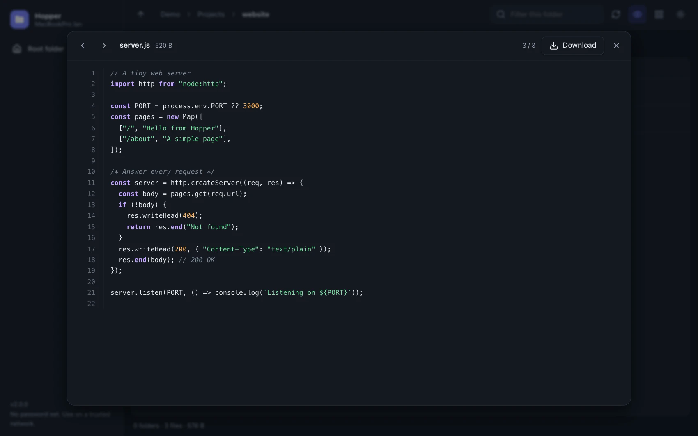
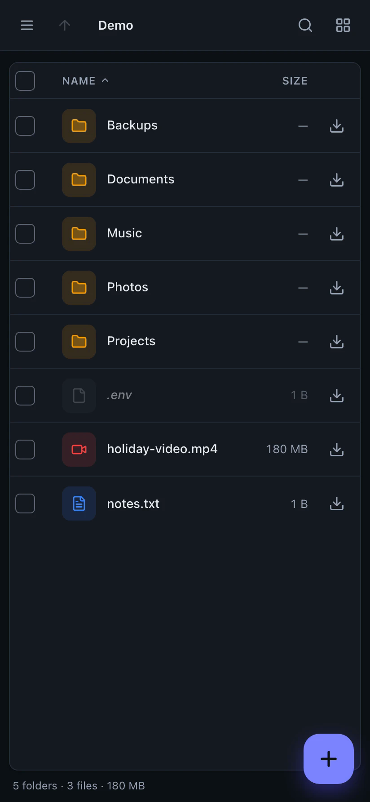
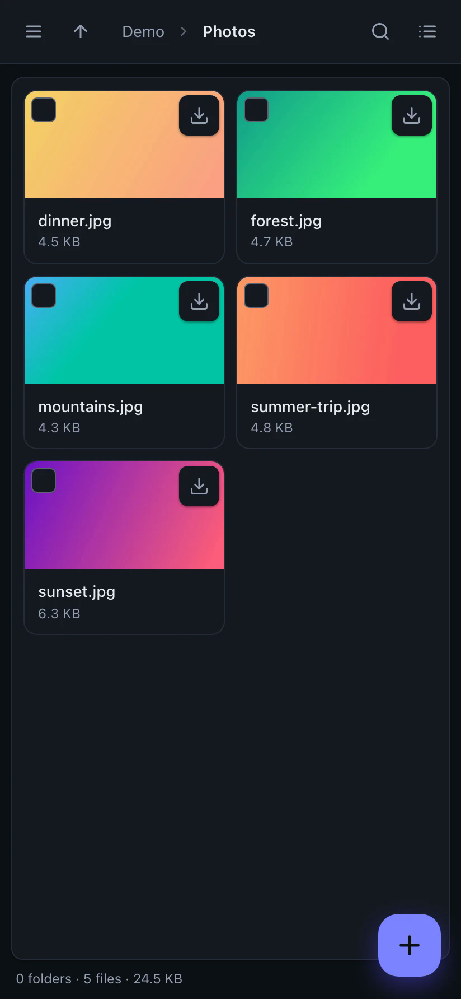
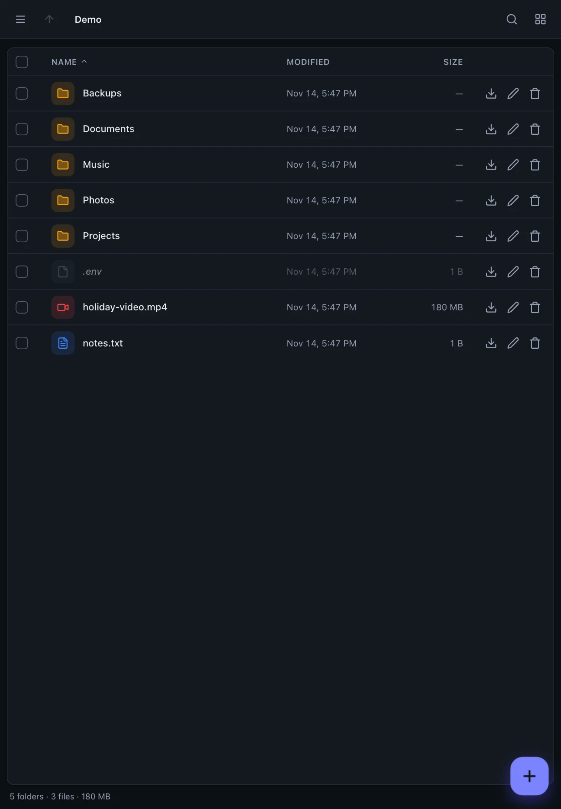

# Hopper

A clean, self-hosted web file manager with **zero dependencies**. Clone it, run it with Node.js, and you can browse, upload, download and organise files on that machine from any browser, on your computer or your phone.

**No third-party packages, so there is no supply chain to attack.** Other self-hosted file managers pull in dozens or hundreds of npm packages, and one hijacked package is enough to read every file on your server. Hopper uses only Node.js itself: nothing to `npm install` to run it, no `node_modules`, no CDN scripts. All the code that touches your files is in this repo.


<p align="center">
  
  
</p>

<p align="center">
  
  
  
</p>

## Features

1. **A fast, tidy interface:** list or grid view, sorting, a filter box, breadcrumbs you can type into, and light and dark themes.
2. **Upload** files or whole folders with a button or by drag and drop. Big files go up in pieces and **pick up where they stopped** after a network hiccup. You see progress, speed and time left, and you can cancel.
3. **Download** one file, or pick several files and folders (or a whole folder) and get them as **one ZIP**. The ZIP is made by Hopper itself, works for files over 4 GB and folders with more than 65,535 files, and skips re-compressing videos and photos, so it is quick.
4. **Create folders, rename and delete** (deleting asks first).
5. **Preview in the browser** instead of downloading: images, video, audio, PDF, and any text or code file (`.js`, `.py`, `.json`, `Dockerfile`, logs and more) with colours, line numbers, and the arrow keys to move to the next or previous file.
6. **Keyboard shortcuts:** `/` filter, `Ctrl/Cmd+A` select all, `F2` rename, `Delete` delete, `Alt+↑` parent folder, `Ctrl/Cmd+L` type a path.
7. Works well on **phones and tablets**.
8. **Never overwrites:** uploading `photo.jpg` twice gives you `photo (1).jpg`.

## How to run it

```bash
git clone https://github.com/p32929/hopper.git
cd hopper
node server.js
```

Then open `http://<server-ip>:3999`. Press `Ctrl+C` to stop it. Needs Node.js 18 or newer.

| Setting | What it does | Default |
| --- | --- | --- |
| `PORT` | Port to listen on | `3999` |
| `HOST` | Address to listen on (`127.0.0.1` = this machine only) | `0.0.0.0` |
| `FM_ROOT` | Lock the manager to one folder (it cannot go above it) | the whole machine |
| `FM_PASSWORD` (or `--password=...`) | Ask for this password before showing anything | no password |
| `FM_TRUST_PROXY` | Set to `1` behind a reverse proxy so the visitor's real address is used | off |

```bash
PORT=8080 FM_ROOT=/srv/share node server.js
```

## Password

```bash
FM_PASSWORD='something long' node server.js
# or
node server.js --password='something long'
```

Everyone then sees a sign-in page first, and nothing else (not even the app files) until the password is right. Sessions last 7 days, and there is a **Sign out** button.

**Wrong passwords are limited to 5.** On the 5th mistake the visitor's **IP address and browser** are both blocked for 7 days, and a blocked visitor gets nothing, not even with the correct password. The block list is kept in memory, so **restarting the server lifts every block**. Mistakes are counted per visitor, and a correct password resets that visitor's count.

Tips: use a long password, and put HTTPS in front of it (a reverse proxy such as Caddy or nginx) if you reach it over the internet, because the password is sent as typed. Behind a proxy set `FM_TRUST_PROXY=1` so blocking uses each visitor's real address.

## Tests

```bash
npm test            # API and password tests (no install needed)
npm install         # once, for the browser tests
npm run test:e2e    # real-browser tests (uses your installed Chrome)
```

Both can also run against a server that is already running: `BASE_URL=http://host:3999 npm run test:e2e`.

## When to use it

1. You need a quick file transfer without setting up FTP, SFTP or SSH.
2. You want a simple way to look after files on a home server, Raspberry Pi or VM.
3. You want full control over exactly where files land.

## When NOT to use it

1. **Without a password, when security matters.** Without `FM_PASSWORD` there is **no login**: anyone who can reach the port can read, upload, rename and delete files. Set a password, use it on a trusted network, or bind it with `HOST=127.0.0.1`.
2. When you need several users with their own permissions.

> Never expose it to the public internet without a password and HTTPS.

## License

MIT License — Copyright (c) Fayaz Bin Salam. See [LICENSE](LICENSE) for the full text.

## Contributing

Contributions are very welcome, thank you! Before you start on a pull request, please open an issue and tell me what you would like to add or change. That way we can agree on it first, and your time is not wasted on something that might not fit. Thanks for helping make Hopper better.

## You might also like

<p><a href="https://openstore.pfay.workers.dev/more/p32929/hopper/personal/0"><picture><source media="(prefers-color-scheme: dark)" srcset="https://openstore.pfay.workers.dev/more/p32929/hopper/personal/0-dark.svg"></picture></a><a href="https://openstore.pfay.workers.dev/more/p32929/hopper/personal/1"><picture><source media="(prefers-color-scheme: dark)" srcset="https://openstore.pfay.workers.dev/more/p32929/hopper/personal/1-dark.svg"></picture></a><br><a href="https://openstore.pfay.workers.dev/more/p32929/hopper/personal/2"><picture><source media="(prefers-color-scheme: dark)" srcset="https://openstore.pfay.workers.dev/more/p32929/hopper/personal/2-dark.svg"></picture></a><a href="https://openstore.pfay.workers.dev/more/p32929/hopper/personal/3"><picture><source media="(prefers-color-scheme: dark)" srcset="https://openstore.pfay.workers.dev/more/p32929/hopper/personal/3-dark.svg"></picture></a></p>

<p><a href="https://p32929.github.io/share/?repo=hopper"><picture><source media="(prefers-color-scheme: dark)" srcset="https://p32929.github.io/readme/footer-share-dark.svg"></picture></a><a href="https://p32929.github.io/support/"><picture><source media="(prefers-color-scheme: dark)" srcset="https://p32929.github.io/readme/footer-support-dark.svg"></picture></a><br><a href="https://openstore.pfay.workers.dev/add"><picture><source media="(prefers-color-scheme: dark)" srcset="https://p32929.github.io/readme/footer-join-dark.svg"></picture></a></p>
