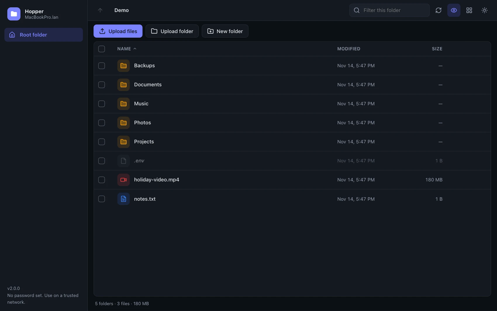
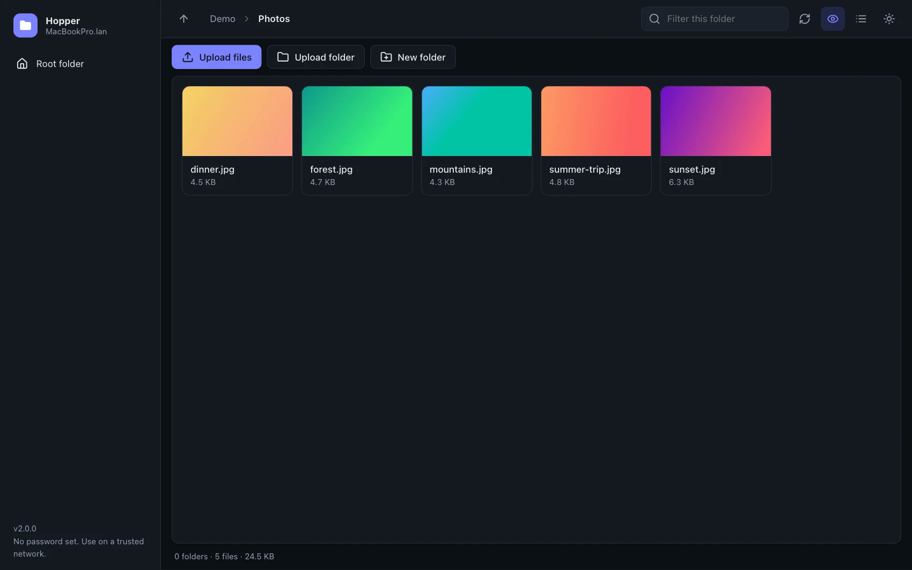

# Hopper

A clean, self-hosted web file manager with **zero dependencies**. Clone it, run it with Node.js, and you can browse, upload, download and organise files on that machine from any browser, on your computer or your phone.



<p align="center">
  
  
</p>

<p align="center">
  
  
  
</p>

## Features

- **Fast, tidy interface**: list or grid view, sorting, filter box, breadcrumbs you can type into, light and dark theme
- **Upload** files or whole folders by button or drag and drop. Big files go up in chunks and **resume** after a network hiccup. Live progress, speed, time left and cancel
- **Download** a file, or select several files and folders and get them as **one ZIP** (built in pure Node, nothing to install)
- **Create folders, rename and delete** (with a confirmation)
- **Preview in the browser** instead of downloading: images, video, audio, PDF, and any text or code file (`.js`, `.py`, `.json`, `Dockerfile`, logs and more) with syntax colours, line numbers and next/previous with the arrow keys
- **Keyboard shortcuts**: `/` filter, `Ctrl/Cmd+A` select all, `F2` rename, `Delete` delete, `Alt+↑` parent folder, `Ctrl/Cmd+L` type a path
- Works well on **phones and tablets**
- Never overwrites: uploading `photo.jpg` twice gives `photo (1).jpg`

## How to run it

```bash
git clone https://github.com/p32929/hopper.git
cd hopper
node server.js
```

Then open `http://<server-ip>:3999`. Press `Ctrl+C` to stop it. Needs Node.js 18 or newer.

| Setting | What it does | Default |
| --- | --- | --- |
| `PORT` | Port to listen on | `3999` |
| `HOST` | Address to listen on (`127.0.0.1` = this machine only) | `0.0.0.0` |
| `FM_ROOT` | Lock the manager to one folder (it cannot go above it) | the whole machine |
| `FM_PASSWORD` (or `--password=...`) | Ask for this password before showing anything | no password |
| `FM_TRUST_PROXY` | Set to `1` behind a reverse proxy so the visitor's real address is used | off |

```bash
PORT=8080 FM_ROOT=/srv/share node server.js
```

## Password

```bash
FM_PASSWORD='something long' node server.js
# or
node server.js --password='something long'
```

Everyone then sees a sign-in page first, and nothing else (not even the app files) until the password is right. Sessions last 7 days, and there is a **Sign out** button.

**Wrong passwords are limited to 5.** On the 5th mistake the visitor's **IP address and browser** are both blocked for 7 days, and a blocked visitor gets nothing, not even with the correct password. The block list is kept in memory, so **restarting the server lifts every block**. Mistakes are counted per visitor, and a correct password resets that visitor's count.

Tips: use a long password, and put HTTPS in front of it (a reverse proxy such as Caddy or nginx) if you reach it over the internet, because the password is sent as typed. Behind a proxy set `FM_TRUST_PROXY=1` so blocking uses each visitor's real address.

## Tests

```bash
npm test            # API and password tests (no install needed)
npm install         # once, for the browser tests
npm run test:e2e    # real-browser tests (uses your installed Chrome)
```

Both can also run against a server that is already running: `BASE_URL=http://host:3999 npm run test:e2e`.

## When to use it

- You need a quick file transfer without setting up FTP, SFTP or SSH
- You want a simple way to look after files on a home server, Raspberry Pi or VM
- You want full control over exactly where files land

## When NOT to use it

- **If security matters and you have not set a password.** Without `FM_PASSWORD` there is **no login**: anyone who can reach the port can read, upload, rename and delete files. Set a password, use it on a trusted network, or bind it with `HOST=127.0.0.1`.
- Multi-user setups with permissions

> Never expose it to the public internet without a password and HTTPS.

## License

MIT License — Copyright (c) Fayaz Bin Salam. See [LICENSE](LICENSE) for the full text.

## Contributing

Contributions are warmly welcomed and greatly appreciated! Whether it's a bug fix, new feature, or improvement, your input helps make this project better for everyone.

Before submitting a pull request, please:

1. Create an issue describing the feature or bug fix you'd like to work on
2. Wait for discussion and approval to ensure alignment with project goals
3. Fork the repository and create your feature branch
4. Submit your pull request with a clear description of changes

This approach helps avoid duplicate efforts and ensures smooth collaboration. Thank you for considering contributing!

## Share

Sharing this repository with your friends is just one click away from here

[](https://www.facebook.com/sharer/sharer.php?u=https://github.com/p32929/node_file_manager_server/)
[](https://twitter.com/intent/tweet?url=https://github.com/p32929/node_file_manager_server/)
[](https://www.tumblr.com/share?v=3&u=https://github.com/p32929/node_file_manager_server/)
[](https://getpocket.com/save?url=https://github.com/p32929/node_file_manager_server/)
[](https://pinterest.com/pin/create/button/?url=https://github.com/p32929/node_file_manager_server/)
[](https://www.reddit.com/submit?url=https://github.com/p32929/node_file_manager_server/)
[](https://www.linkedin.com/shareArticle?mini=true&url=https://github.com/p32929/node_file_manager_server/)
[](https://api.whatsapp.com/send?text=https://github.com/p32929/node_file_manager_server/)

<!-- hire-block -->

---

## 💼 Using this at a company?

I do fixed-price delivery work on my own projects. One invoice, one date, no hourly billing:

| | |
|---|---|
| **White-label build** — this project rebranded, extended and deployed as yours | **$6,500** · 3 weeks |
| **Custom app from scratch** on my own stack, signed and auto-updating | **$12,500** · 6 weeks |
| **Production-hardening sprint** — 72 hours on this project, for your load and your security review | **$999** |
| **Ongoing capacity** — one project-week of my time reserved every month | **$9,000 / month** |

Full details → **[p32929.github.io/hire](https://p32929.github.io/hire/)** · Email **[fayazdevinbox@uberip.com](mailto:fayazdevinbox@uberip.com)** — scoping and quotes are free and I answer within one business day.
